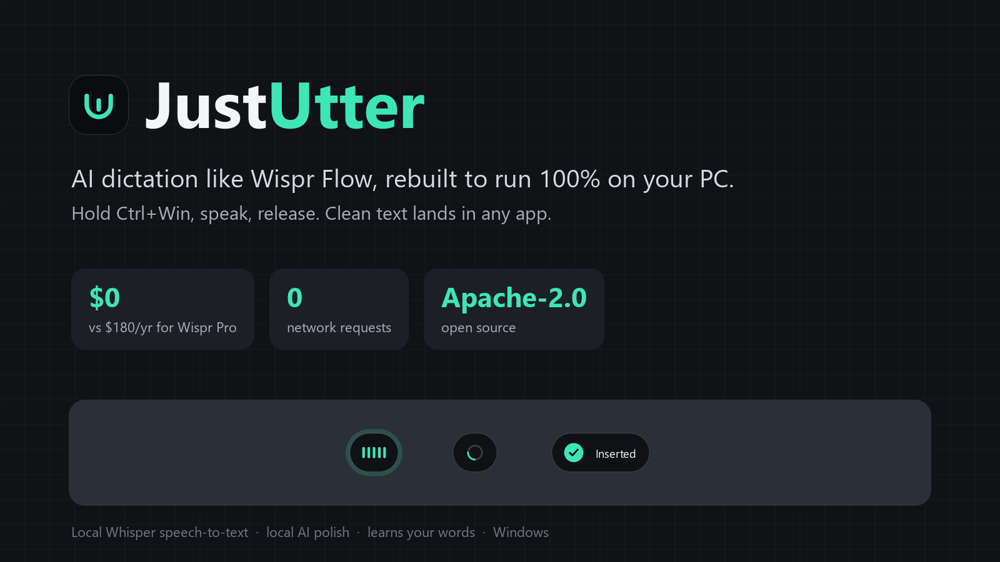

# JustUtter: free, local, open-source AI dictation for Windows



Hold **Ctrl+Win**, speak, release. Clean text appears in whatever app you're typing in (Notepad, Gmail,
Slack, VS Code, a terminal). Speech recognition runs **on your PC**: no account, no subscription,
no word cap, and **zero network requests** at runtime.

Built for **Autonomous SG 2026 · NUS Hackers** ("reverse engineer something expensive and make it
cheap and open").

## The expensive old thing: Wispr Flow

| | Wispr Flow | **JustUtter** |
|---|---|---|
| Price | Pro **$15/user/month** or $144/year; free tier capped at **2,000 words/week** on desktop ([pricing](https://wisprflow.ai/pricing), [plans](https://docs.wisprflow.ai/articles/9559327591-flow-plans-and-what-s-included)) | **$0**, unlimited |
| Where speech is processed | "An internet connection is required for transcription" ([docs](https://docs.wisprflow.ai/articles/2772472373-what-is-flow)) | On-device Whisper; works with Wi-Fi off |
| Account | Required | None |
| Source | Proprietary | **Apache-2.0** |
| Reach | "Millions of consumers and 100,000 businesses"; $2B valuation, Aug 2026 ([Fortune](https://fortune.com/2026/08/17/wispr-2-billion-valuation-dictations-only-the-beginning/), [TechCrunch](https://techcrunch.com/2026/08/17/wispr-raises-280m-at-2b-valuation-as-it-looks-beyond-dictation/)) | You, for free |

**Saving per user:** $180/year against Wispr Pro billed monthly, or $144/year against annual billing.
Other paid dictation apps: Willow Pro $15/month, Superwhisper Pro $8.49/month.

## What we uncovered, and how we know it works

We studied Wispr Flow through its **public documentation and observable behaviour**. Its Terms of
Service (§3A) forbid decompiling the app, so we didn't. The evidence table is in [`SPEC.md`](SPEC.md):
the Ctrl+Win hold gesture, cloud-only transcription, the Smart Formatting commands, Backtrack, the
"Undo AI edit" flow, context reading, and the password-field exclusions. Each feature we rebuilt, where
it came from, and why ours is better is in [`FEATURES.md`](FEATURES.md).

How we know it works:
- **133 automated tests**, including 26 clean-up eval cases and 10 AI-polish safety cases.
- **Speech evals** on this laptop: CPU only, int8, 10 locally generated clips
  ([`utter/evals/results.md`](utter/evals/results.md)).

| Model | Median release-to-text | Glossary / command checks | Network requests |
|---|---:|---:|---:|
| Whisper base.en (fast mode) | **0.58 s** | **100%** | **0** |
| Whisper small.en (default, more accurate on rare words) | 1.69 s | 100% | 0 |

## Features
- **Hold-to-talk anywhere** (Ctrl+Win, remappable), plus **hands-free long dictation**
  (Ctrl+Win+Space; finish with Ctrl+Win, cancel with Esc). Long recordings are transcribed in chunks
  while you talk.
- **AI polish on-device:** a local LLM (qwen2.5:1.5b via [Ollama](https://ollama.com), 127.0.0.1 only)
  fixes grammar and self-corrections in about 0.7 s. Every rewrite is validated, and anything unsafe
  falls back to the rule-based text ([`utter/evals/polish_results.md`](utter/evals/polish_results.md):
  10/10).
- **Personal memory:** learns your vocabulary and style; **Ctrl+Alt+L** learns from text you corrected.
  Stored locally, viewable, and deletable.
- **Proof of local:** a runtime network guard blocks and counts outbound connections; the dashboard
  shows "Network requests: 0".
- **Clean-up you can audit:** removes fillers, handles "new line" / "new paragraph" and "scratch that"
  (backtrack); keeps the raw text and lists every change.
- **Personal glossary:** biases Whisper toward your terms *and* fixes them afterwards. "Learn
  correction" from history asks for your confirmation first.
- **Snippets:** "insert my email" inserts static text and is never executed.
- **App-aware modes:** chat drops the trailing period, email adds final punctuation, dev leaves casing
  alone. JustUtter reads only the app name and window title, never your text or screen.
- **Safe delivery:**
  - Your clipboard is restored after pasting.
  - If you switch windows mid-dictation, JustUtter copies the text instead of pasting it.
  - Password managers are blocked.
  - If the transcript is uncertain, the pill says "Didn't catch that" instead of inserting a guess.
- **Ctrl+Alt+Z** swaps the cleaned text for the raw transcript in one keystroke.
- **Dashboard** (Ctrl+Alt+U or click the pill): savings, words over Wispr's free cap, latency,
  history, glossary.

## Install and run (Windows 10/11, Python 3.12)

```powershell
cd utter
python -m venv .venv
.venv\Scripts\python -m pip install -e .[dev]
.venv\Scripts\python -m utter download-model   # one-time, ~600 MB for both models (needs internet)
# optional AI polish: install Ollama (winget install Ollama.Ollama), then:
ollama pull qwen2.5:1.5b                       # one-time, ~1 GB
run.bat                                        # or: .venv\Scripts\python -m utter
```

After the one-time model download, JustUtter never touches the network.

Settings, glossary and snippets live in `%APPDATA%\Utter\config.json` (validated on load; an invalid
file is moved aside, never deleted). Logs are in `%APPDATA%\Utter\utter.log`. Audio is never saved.

## Development

```powershell
cd utter
.venv\Scripts\python -m pytest -q        # tests
.venv\Scripts\ruff check .               # lint
.venv\Scripts\mypy utter tests           # types (strict)
powershell -File evals\make_audio.ps1    # generate speech eval clips (Windows TTS)
.venv\Scripts\python -m utter eval       # speech evals -> evals/results.md
```

Architecture: `hotkey` (chord state machine) → `audio` (16 kHz capture) → `transcriber`
(faster-whisper, CPU int8, VAD) → `cleanup` (deterministic rules) → `context` (app category) →
`paste` (clipboard transaction) → `ui` (pill and dashboard). `netguard` enforces offline operation.

## Known limits (honest list)
- Simulated paste can't reach apps running **as administrator** (Windows blocks it). JustUtter copies the
  text so you can paste manually.
- "new line" is a command even mid-sentence ("draw a new line"), the same trade-off Wispr documents.
- English models only for now; multilingual Whisper models are a config change away.
- Clean-up is rule-based, not an LLM. That's deliberate (predictable and explainable). An optional
  local LLM rewrite is on the roadmap.

## Licence
[Apache-2.0](LICENSE). See [`NOTICE`](NOTICE) and [`THIRD_PARTY_NOTICES.md`](THIRD_PARTY_NOTICES.md).
JustUtter is independent and not affiliated with Wispr AI, Inc.
